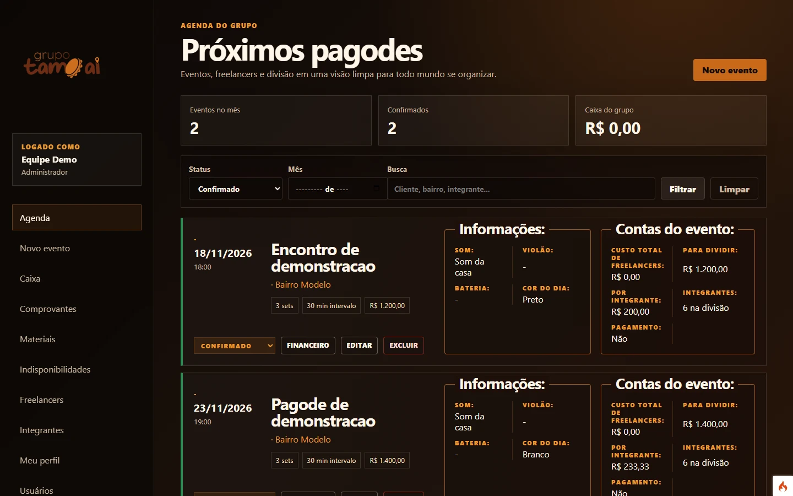
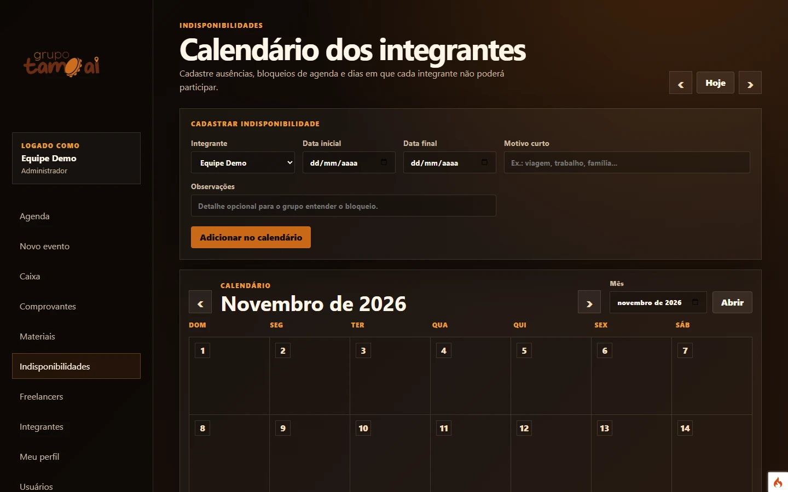
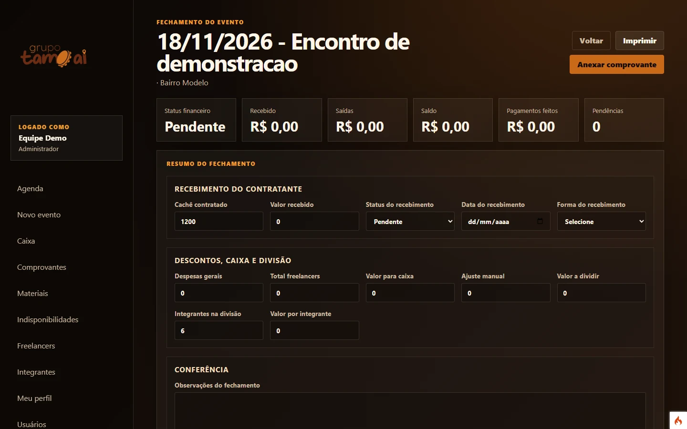

# Tamo Aí

Aplicação web para organizar apresentações e a operação de um grupo musical. Agenda, formação de cada evento, fechamento financeiro, caixa, comprovantes e disponibilidade dos integrantes ficam no mesmo ambiente.

Desenvolvido por **Matheus Moraes / MADEBYTHEUX**, com PHP, CodeIgniter 4 e MySQL. Esta é a versão independente do módulo utilizado pelo Grupo Tamo Aí.



## Funcionalidades

- **Agenda** com datas, horários, local, status, formação, condições de apresentação e freelancers vinculados.
- **Fechamento por evento** com recebimento do contratante, despesas, reserva para o grupo, divisão entre integrantes e controle dos pagamentos.
- **Caixa** com entradas e saídas, categorias, filtros e exportação CSV. Adiantamentos destinados aos integrantes aparecem separados do caixa do grupo.
- **Comprovantes** em PDF, JPG, PNG ou WebP, com vínculo ao evento e download autenticado.
- **Indisponibilidades** em calendário mensal. Cada integrante cadastra e edita as próprias datas. O administrador pode gerir o calendário do grupo.
- **Materiais pendentes** com preço, link de compra, status, urgência e prazo desejado.
- **Integrantes e freelancers** com dados de contato, instrumento e informações de pagamento.
- **Histórico de ações** para acompanhar alterações financeiras e administrativas.

O código também contém relatórios e envio de fechamentos por e-mail, acessíveis pelas respectivas rotas. Esses recursos estão fora do menu principal, conforme a configuração atual da aplicação.

## Perfis

| Perfil | Uso |
| --- | --- |
| Administrador | Gerencia usuários, agenda, operação e finanças. |
| Financeiro | Acessa as funções de gestão financeira, comprovantes e freelancers. |
| Integrante | Consulta a agenda e os dados do grupo, atualiza o próprio perfil e registra a própria indisponibilidade. |

As permissões são verificadas nos controladores e no filtro de autenticação. O layout adapta a navegação e as ações ao perfil conectado.

## Stack

PHP 8.2+, CodeIgniter 4.7, MySQL/MariaDB, HTML, CSS e JavaScript. O Composer instala as dependências PHP. A interface usa os próprios estilos do módulo, com formulários e calendário renderizados no servidor.

## Instalação local

Tenha PHP 8.2 ou superior com `intl`, `mbstring`, `mysqli`, `fileinfo` e `dom`, Composer 2 e MySQL 8 ou MariaDB 10.6+. Para instalar os pacotes pelo Composer, habilite também `zip` ou disponibilize `unzip` no sistema.

```sh
git clone https://github.com/iMoraies/tamo-ai.git
cd tamo-ai
composer install
cp .env.example .env
```

No PowerShell, use `Copy-Item .env.example .env` para copiar o arquivo de configuração.

Crie um banco vazio com codificação `utf8mb4`. Importe a estrutura pelo phpMyAdmin ou pelo terminal.

```sh
mysql -u seu_usuario -p tamo_ai < database/schema.sql
```

Preencha no `.env` a URL e as credenciais do seu banco. O `schema.sql` contém a estrutura atual das tabelas, com índices e campos necessários ao módulo. Os dados de utilização são cadastrados depois da instalação.

```ini
app.baseURL = 'http://localhost:8080/'
database.default.hostname = localhost
database.default.database = tamo_ai
database.default.username = seu_usuario
database.default.password = 'sua_senha'
```

Gere a chave da aplicação e crie o primeiro administrador. O segundo comando solicita nome, e-mail e senha no terminal.

```sh
php spark key:generate
php spark tamoai:admin
php spark serve --host localhost --port 8080
```

Abra **http://localhost:8080/index.php/tamo-ai/entrar**. Após entrar, o administrador pode cadastrar as demais contas em **Usuários**.

## Uso

1. Cadastre os integrantes e os freelancers que participam das apresentações.
2. Crie um evento com data, local, formação e valor contratado.
3. Registre recebimentos, despesas e pagamentos na página financeira do evento.
4. Anexe os comprovantes e acompanhe o caixa do grupo.
5. Use o calendário para verificar conflitos de disponibilidade antes de confirmar novas datas.





As capturas deste README usam registros fictícios de demonstração.

## Publicação em hospedagem

Configure o domínio para apontar para `public/`. As pastas `app`, `vendor`, `database` e `writable` ficam acima da pasta pública. Instale as dependências com `composer install --no-dev`, importe a estrutura e configure o `.env` do servidor.

```ini
CI_ENVIRONMENT = production
app.baseURL = 'https://seu-dominio.com/'
app.forceGlobalSecureRequests = true
cookie.secure = true
```

Em Apache com `mod_rewrite`, o `.htaccess` permite usar `/tamo-ai/entrar`. Para retirar `index.php` dos links, defina `app.indexPage = ''` no `.env`. A pasta `writable/` precisa de permissão de escrita para sessões, cache, logs e arquivos enviados.

Os comprovantes são armazenados em `writable/uploads/tamo-ai/comprovantes/`, com acesso por download autenticado. Faça o backup do banco e dessa pasta em conjunto para preservar os vínculos entre registros e arquivos.

## Envio de fechamentos por e-mail

Cadastre destinatários em `/tamo-ai/emails` com um perfil autorizado e configure `TAMOAI_SMTP_HOST`, `TAMOAI_SMTP_USER`, `TAMOAI_SMTP_PASS`, `TAMOAI_SMTP_PORT`, `TAMOAI_SMTP_CRYPTO` e `TAMOAI_EMAIL_FROM` no `.env`. Há um modelo de fechamento em `app/Views/tamoai/emails/templates/closing.php`.

## Organização

```text
app/
  Commands/CreateAdmin.php   Criação da conta inicial
  Config/                   Configuração e rotas do módulo
  Controllers/TamoAi/        Agenda, finanças, caixa e operação
  Filters/TamoAiAuth.php     Autenticação das rotas
  Models/TamoAi*.php         Acesso às tabelas do módulo
  Views/tamoai/              Telas e impressão
database/schema.sql         Estrutura para instalação
docs/images/                Capturas de demonstração
public/assets/              Estilos e marca do grupo
writable/                   Sessões, logs e arquivos locais
```

A extração preserva as rotas `/tamo-ai`, os modelos e as telas do módulo. O controlador base e os filtros foram reduzidos às dependências necessárias à instalação independente.

O `.gitignore` mantém a configuração local, dependências instaladas e arquivos de utilização fora do versionamento. O arquivo `LICENSE` preserva a licença que acompanha a base CodeIgniter utilizada no projeto.

**Autor** · [Matheus Moraes](https://github.com/iMoraies) · [madebytheux.com](https://madebytheux.com)
